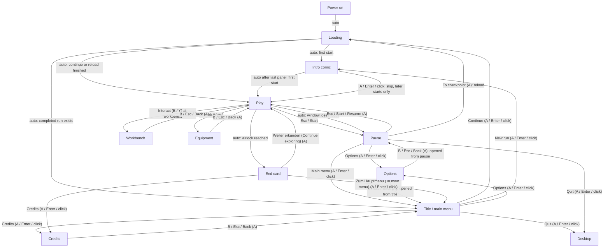

# UX specification — milestone 1

This document is the binding screen-flow, HUD and input specification for milestone 1; menu, HUD and screen tasks may start only after neVs approves it. It describes the state at the base commit, separates what exists from what is still to build, and leaves look, motion and sound to the menu style guide.

## Screen flow

The flow covers the whole M1 session; labels name the triggering input, and "auto" means no player input. Options returns to whichever screen opened it.

## Screens

| Screen | Purpose | Today |
|---|---|---|
| Loading | Start, continue and checkpoint-reload indicator; no freeze longer than one second. | new |
| Intro comic | Up to six panels and 60 seconds before the first run; unskippable on the very first start, skippable afterwards. | new |
| Title / main menu | „Fortsetzen“ (Continue), „Neue Runde“ (New run), „Beenden“ (Quit); Options, Credits and a version label are new. | `game/start.gd`, `game/start.tscn`, `game/modules/ui/start_menu.gd` |
| Play | Route, combat, HUD and interactable stations. | `game/main.tscn`, `game/main.gd`, `game/lab_route.gd` |
| Pause | Pauses the tree on Esc, Start or focus loss: „Weiter“ (Resume), „Zum Kontrollpunkt“ (To checkpoint), „Spiel beenden“ (Quit game); Options and „Hauptmenü“ (Main menu) are new. | `game/pause_controller.gd`, `game/modules/ui/pause_menu.gd` |
| Options | Audio volumes (master, music, effects, voices), window mode, VSync, subtitles, slow motion and screen shake; saved separately; no key rebinding in M1. | `game/modules/ui/menu_screen.gd`, `game/modules/ui/options_menu.gd` (built, not wired yet) |
| Credits | Credits, licence and project page; from the title and after the end card. | new |
| End card | „SEKTOR GESICHERT“ (Sector secured) summary with guards, shards, weapon, armour and save status; continue, credits or main menu. | `game/modules/ui/sector_complete.gd` |
| Workbench | In-game weapon and equipment purchase and mod station. | `game/modules/ui/workbench_menu.gd` |
| Equipment | In-game overview for weapon, armour and shield. | `game/modules/ui/equipment_menu.gd` |

## HUD layout

| Element | Position | Shows | Source |
|---|---|---|---|
| Rend status panel | top left, margin 20 px | „REND“, HP bar with „HP n/n“, stamina bar when the shield is unlocked, and an equipment line | `game/modules/ui/combat_hud.gd` |
| Zone and counters | top right, margin 20 px | zone label (for example „ANKUNFT“); „Wachen n/n“ (guards defeated/total); „Splitter n“ (shards), plus „Servo“ when unlocked | `game/modules/ui/combat_hud.gd` |
| Objective | bottom left | current objective text, for example shard recovery or securing the sector | `game/modules/ui/combat_hud.gd` |
| Feedback / toast lane | bottom centre on wide screens, above the prompt on narrow screens | contextual hints and short messages; priority prevents routine hints from replacing combat or save messages | `game/modules/ui/combat_hud.gd`, `game/modules/ui/feedback_priority.gd`, `game/modules/ui/combat_hint_text.gd` |
| Interact prompt | bottom centre | prompts for pickups, checkpoints, workbenches and doors, such as „E / Y: Interagieren“ (interact) | `game/modules/ui/combat_hud.gd` |
| Save warning | bottom centre, above feedback | „Speichern fehlgeschlagen“ (saving failed); never hidden behind ordinary feedback | `game/modules/ui/combat_hud.gd` |
| Control footer | bottom right | „I / Select Ausrüstung · F1 Hilfe · Esc / Start Pause“ (equipment, help, pause); shortened when narrow | `game/modules/ui/combat_hud.gd` |
| Ammo readout | bottom right, above the footer, only while a firearm is drawn | gun name and mods, „magazine / reserve“, round pips, reload bar, „NACHLADEN“ (reloading) or „R — LADEN“ (load) | `game/modules/ui/ammo_hud.gd` |
| Overseer status | bottom centre, above the objective band | „LABOR-AUFSEHER“ (lab overseer), „Phase n“ or „STANDHAFT“ (braced), and the boss health bar | `game/modules/ui/overseer_status.gd` |
| Edge threat indicator | left or right screen edge, at 45 % of screen height | inward triangle for an off-screen threat; no flashing | `game/modules/ui/edge_threat_indicator.gd` |
| Help panel | centre, only while help is visible | German control list, toggled with F1 | `game/modules/ui/combat_hud.gd` |

## Input map

| Action | Keyboard / mouse | Gamepad (Xbox names) | Source |
|---|---|---|---|
| Move left / right | A / D or left / right arrow | left stick, D-pad left / right | `game/project.godot:26` |
| Move depth up / down | W / S or up / down arrow | left stick, D-pad up / down | `game/project.godot:51` |
| Jump | Space | A | `game/project.godot:34` |
| Attack (melee) | J or X | X | `game/project.godot:38` |
| Guard | L or right mouse button | LB | `game/player.gd:147` |
| Fire (drawn gun) | U or left mouse button | RT | `game/player.gd:171` |
| Reload | R | left stick click (L3) | `game/player.gd:166` |
| Interact | E | Y | `game/lab_route.gd:208` |
| Weapon slots 1–4 | 1, 2, 3, 4 | none; missing | `game/player.gd:156` |
| Weapon next / previous | mouse wheel down / up | Back (View) cycles next only; previous is missing | `game/player.gd:161` |
| Dodge | Shift or K | B | `game/project.godot:43` |
| Crouch / duck | C or Ctrl | RB | `game/project.godot:47` |
| Pause | Esc | Start | `game/pause_controller.gd:44` |
| Equipment overview | I | Back (View) | `game/pause_controller.gd:41` |
| Restart route | R | none; missing | `game/project.godot:59`, `game/main.gd:103` |
| Help | F1 | none; missing | `game/lab_route.gd:216` |
| Menu navigate / confirm / back | arrow keys, Enter or Space, Esc | D-pad or stick, A, B | `game/modules/ui/menu_screen.gd:195` |

**Conflicts and gaps.** R is bound to reload (`game/player.gd:169`) and the route-restart shortcut (`game/project.godot:59`), so reload also opens the restart confirmation. Back (View) is bound to weapon-next (`game/player.gd:165`) and the equipment overview (`game/pause_controller.gd:41`). No gamepad binding exists for the four weapon slots, weapon-previous, restart or help. Code-created events leave the device at the engine default; this is documented here, not fixed in this task.

## Accessibility

| M1 requirement (G16) | Set on | Notes |
|---|---|---|
| Subtitles for announcements | Options | „Subtitles“ switch; reachable from title and pause; saved with the other settings. |
| Slow motion can be switched off | Options | „Slow motion“ switch; applied and saved. |
| Screen shake can be switched off | Options | „Screen shake“ switch; applied and saved. |
| Alarm light flashes at 3 Hz or less | Play | Fixed game rule, not a player option; alarm lights must never flash faster than 3 Hz. |
| Danger never shown by colour alone | Play | Fixed G-5 rule; warnings use shape, motion or text as well as colour, not a toggle. |

## Open questions for neVs

1. **When does the intro comic play?** Recommendation: play it on every „Neue Runde“ (New run), forced only on the first start of a fresh profile, skippable later; „Fortsetzen“ (Continue) never replays it.
2. **Where do the credits sit after the end card?** Recommendation: add a „Credits“ row to the end card; credits return to the end card so the player can still continue or go to the title.
3. **Does „Hauptmenü“ (Main menu) in the pause menu need confirmation?** Recommendation: confirm when progress is unsaved, following the existing end-card pattern, and return to the title without deleting the checkpoint save.
4. **What happens to the R conflict?** Recommendation: keep R for reload only and remove the in-play restart shortcut in M1; restart stays under Pause → „Zum Kontrollpunkt“ (To checkpoint).
5. **How should gamepad weapon switching work without new rebinding?** Recommendation: keep Back (View) for equipment, accept “next only” weapon cycling on the gamepad in M1, and give both directions non-conflicting bindings in E11.8.
